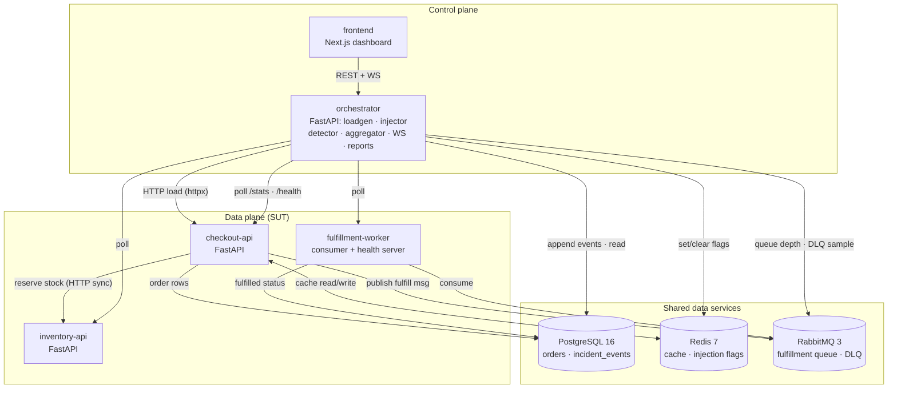
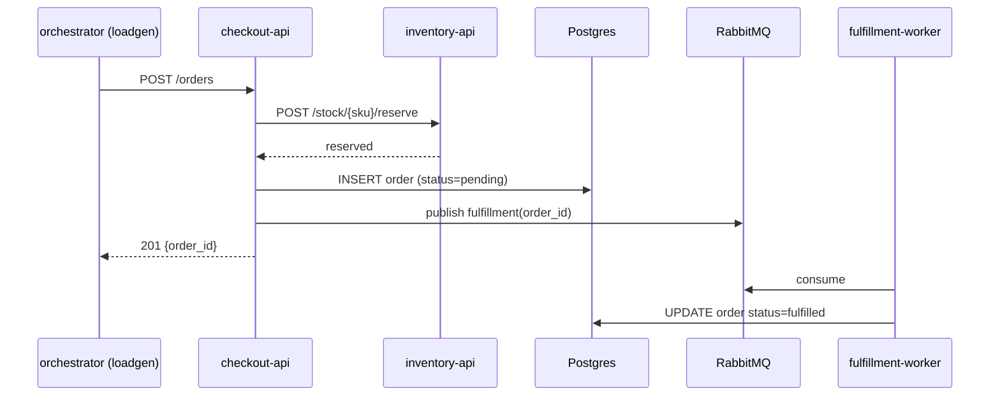

# Failover Forge

[](https://github.com/ryan-gabriel/FailoverForge/actions/workflows/ci.yml)
[](LICENSE)

**A chaos-engineering training ground: break a real 3-service system on purpose and watch the blast radius propagate live.**

Failover Forge is a small but *real* order/checkout system you can sabotage from a control panel. Inject latency, errors, a crashed container, queue saturation, or a cache outage — then watch p95 climb, errors cascade across service boundaries, the queue back up, and the cache hit rate collapse. Every failure is recorded as an append-only event, so a **replayable incident timeline** and a generated **post-incident report** (root cause, blast radius, MTTR) fall out of the same data.

Most portfolio projects show the happy path. This one *is* the failure path.

```
┌──────────────────────┐        ┌────────────────────────────────────────────┐
│  frontend (Next.js)  │◀──────▶│  orchestrator (FastAPI control plane)      │
│  live dashboard      │  WS    │  loadgen · injector · detector · eventstore │
└──────────────────────┘        │  aggregator · WS hub · report generator     │
                                └───────────────┬────────────────────────────┘
                                                │ drives load, sets flags, polls /stats
      ┌─────────────────────────────────────────▼──────────────────────────────┐
      │  DATA PLANE (the System Under Test)                                    │
      │  checkout-api ──▶ inventory-api      fulfillment-worker                │
      │      │  ▲                                ▲                            │
      │      ▼  │                                │                            │
      │  Redis cache/flags   Postgres orders/events   RabbitMQ queue + DLQ    │
      └────────────────────────────────────────────────────────────────────────┘
```

---

## 60-second demo

```bash
cp .env.example .env
docker compose up --build -d          # ~1–2 min on a cold clone
open http://localhost:3000            # the dashboard
```

> Setting it up for real (or verifying it on a fresh machine)?
> **[docs/SETUP.md](docs/SETUP.md)** is the step-by-step runbook with a
> checkpoint after every stage and a troubleshooting table.
> Evaluating this as a portfolio piece? **[docs/RECRUITER.md](docs/RECRUITER.md)**
> is a five-minute case study: decisions, tradeoffs, and a 90-second review path.

Then, on the dashboard:

1. **Start load** — default profile drives mixed traffic through checkout.
2. **Inject latency** on `inventory-api` → the graph lights up the
   `checkout-api → inventory-api` edge; p95 climbs; the incident opens.
3. **Escalate with cache outage** on `checkout-api` → cache hit rate drops,
   Postgres traffic rises.
4. **Inject queue saturation** → queue depth chart climbs, fulfillment lags.
5. **Clear all** → recovery; the incident auto-closes.
6. Open **Incidents → the incident** → scrub the immutable timeline and read the
   generated report (root cause · blast radius · MTTR).

All four failure types produce a *distinct, visible* cascade. No sliders, no fake
metrics — every number on screen comes from a real service polled by the
orchestrator.

### Manual API path (no browser)

```bash
# start a 10 rps load run for 30s
curl -X POST localhost:8000/api/load \
  -H 'content-type: application/json' \
  -d '{"rps": 10, "duration_s": 30}'

# inject 400ms latency on inventory-api for 300s
curl -X POST localhost:8000/api/injections \
  -H 'content-type: application/json' \
  -d '{"service": "inventory-api", "failure_type": "latency", "intensity": 400, "ttl_s": 300}'

# watch the incident + report
curl localhost:8000/api/incidents
curl localhost:8000/api/incidents/<id>/report

curl -X DELETE localhost:8000/api/injections   # clear all → incident closes
```

---

## Architecture

Two planes, deliberately separated:

- **Data plane** — the System Under Test. Real FastAPI services, real
  Postgres/Redis/RabbitMQ, real HTTP and queue traffic. This is what breaks.
- **Control plane** — orchestrator + dashboard. Generates load, injects
  failures, observes via `/stats` + `/health`, records events, reports. It never
  carries business traffic, and the SUT never imports it.



The request path for an order:



---

## Failure model (what you can break)

Injection is **app-level** and works on plain Docker Compose: each SUT service
reads **Redis flags** with a TTL on the hot path and fails *open* (no flag =
healthy, Redis down for flags ≠ crash the SUT).

| Failure | Flag | Symptoms you'll see | Blast radius |
|---|---|---|---|
| **Latency** | `inj:latency:{service}` (ms) | p95 spike, downstream sync call stalls | checkout → inventory edge |
| **Error** | `inj:error:{service}` (0.0–1.0) | error-% spike, client 5xx | inventory errors → checkout 5xx |
| **Crash** | `POST /admin/crash` self-kill | connection refused, container restarts | the whole graph |
| **Queue saturation** | flood messages + `inj:pause_worker` | queue depth climbs, fulfillment lag, DLQ | checkout buffers, lag grows |
| **Cache outage** | `inj:cache_outage=1` | hit rate → 0, Postgres load rises | checkout → Postgres |

Flags are set by the orchestrator's `Injector` (with TTL) and cleared explicitly
or by expiry — a crashed orchestrator cannot permanently poison the SUT.

---

## Concepts demonstrated (actually implemented, not named)

- **Event-sourced incident timeline** — append-only `incident_events` Postgres
  table. Nothing is ever updated or deleted; corrections are new events.
- **Replayability** — any past incident is reconstructable *from the event store
  alone*: the report generator reads only events, never live state.
- **Blast-radius propagation** — a static topology plus live per-node health,
  with cascades highlighted when both ends of an edge are unhealthy.
- **Detection as a heuristic** — the detector polls `/stats` and opens incidents
  on threshold breaches (`error_rate > 0.2`, `p95 > 1000ms`, `queue_depth > 100`),
  not by magic.
- **DLQ + poison-message routing** — the worker retries, then dead-letters; the
  dashboard shows DLQ depth and sample messages.
- **Backpressure *absence*** — the MVP intentionally shows cascading failure
  honestly; circuit breakers are a roadmap item, not a feature.
- **Graceful shutdown** — every service drains work, closes pools/broker
  connections, and the WS hub closes clients with code 1001.

---

## API surface (orchestrator)

| Method | Path | Purpose |
|---|---|---|
| `POST` | `/api/load` | start a load run (`rps`, `duration_s`, profile) |
| `POST` | `/api/load/stop` | stop the current run |
| `GET` | `/api/load` | current run status |
| `POST` | `/api/injections` | inject a failure (`service`, `failure_type`, `intensity`, `ttl_s`) |
| `DELETE` | `/api/injections/{id}` | clear one injection |
| `DELETE` | `/api/injections` | clear all (closes injection incidents) |
| `GET` | `/api/injections` | list active injections |
| `GET` | `/api/metrics/latest` | latest aggregated tick |
| `GET` | `/api/queue` | queue depth, consumers, DLQ samples |
| `GET` | `/api/topology` | static graph (nodes + edges) |
| `GET` | `/api/incidents` | incident list |
| `GET` | `/api/incidents/{id}` | incident detail + events |
| `GET` | `/api/incidents/{id}/report` | generated markdown report |
| `WS` | `/ws` | live stream: `metrics.tick`, `queue.update`, `injection.status`, `incident.status`, `timeline.event` |

Every SUT service exposes `GET /health` and `GET /stats`; the crash endpoint
lives on the internal network only. `docs/API_SPEC.md` is the contract of record.

---

## Project layout

```
services/
  checkout-api/        # orders, cache read-through, MQ publish, inventory call
  inventory-api/       # stock lookup + reserve (in-memory, seeded)
  fulfillment-worker/  # consume queue → fulfilled in PG; poison → DLQ
  orchestrator/        # control plane: loadgen, injector, detector, aggregator,
                       # event store, WS hub, report generator
frontend/              # Next.js 15 dashboard (recharts + plain SVG graph)
docs/                  # PRD, ARCHITECTURE, API_SPEC, USER_GUIDE, TECHNICAL_GUIDE,
                       # SETUP (runbook), RECRUITER (case study)
scripts/               # smoke.sh, seed.sh
```

> New here? The [**User Guide**](docs/USER_GUIDE.md) is the step-by-step
> companion: the big picture, how to run it, how to break it, and what to watch.
> Reading or changing the code? The
> [**Technical Guide**](docs/TECHNICAL_GUIDE.md) explains the internals in plain
> English: data flow, failure mechanics, the event log, and an operational
> runbook — technical terms kept, with a glossary at the end.

---

## Development

```bash
make up          # docker compose up --build -d
make smoke       # end-to-end: order → fulfilled
make seed        # seed demo stock
make test        # pytest across all four Python services
make lint        # ruff check/format + frontend eslint + tsc
make frontend    # npm install + lint + typecheck + build
```

Backend: Python 3.12, FastAPI, `uv`. Frontend: Next.js 15 App Router, React 19,
TypeScript strict, Tailwind 4, recharts. Tests: pytest + pytest-asyncio.

RabbitMQ's default `guest` user is restricted to loopback connections, and
container-to-container traffic is not loopback — so the broker gets a dedicated
non-loopback user from `RABBITMQ_USER` / `RABBITMQ_PASSWORD` in `.env`, and the
four services connect with it. The credentials live in one place; see
[docs/SETUP.md](docs/SETUP.md#8-troubleshooting) for the reset path.

---

## Tradeoffs & decisions

- **App-level injection, not kernel/network chaos.** Works on Compose from day 1
  and stays portable; Chaos Mesh / k3s is explicitly roadmap, not MVP. The
  realistic effects (real queue depth, real p95, real restarts) are genuine.
- **Plain SVG graph, not reactflow.** A 3-node graph didn't justify a heavy
  dependency; the cascade-highlight logic is easier to reason about in-house.
- **Duplicated injection middleware per service, not a shared package.** Keeps
  each container build trivial in the MVP; extraction is a documented escape
  hatch if duplication ever hurts.
- **In-memory inventory stock.** Only orders and events persist to Postgres —
  the incident story is about the event store, and this keeps the demo resettable.
- **`restart: on-failure` for the SUT.** Crash injection relies on compose
  restarting the container; the UI warns, and crash injection is TTL-capped.
- **Heuristic detection thresholds.** Documented constants, not adaptive — the
  point is that detection is *observable and explainable*, not clever.

---

## Notes for a live deploy (Phase 5)

The MVP runs fully offline on Compose with no paid keys. For a public deploy:
injection endpoints are already gated behind `X-Chaos-Token` (enabled via
`REQUIRE_CHAOS_TOKEN=true`), so the dashboard can be public read-only while
injection stays locked. A free-tier Fly.io/Koyeb app + Vercel frontend is the
planned path; the fallback is the recorded demo clip. No cloud dependency is
required to run or evaluate the project locally.

---

## License

MIT (portfolio project).
