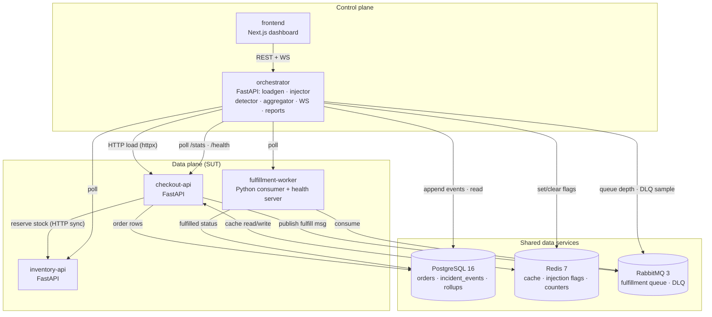
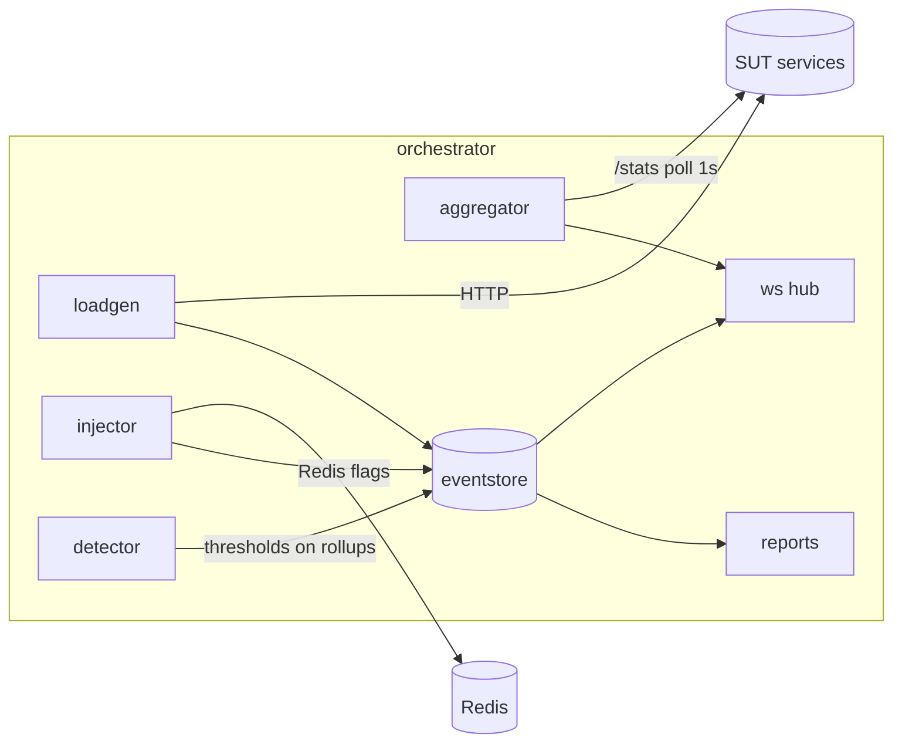
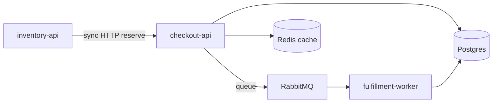
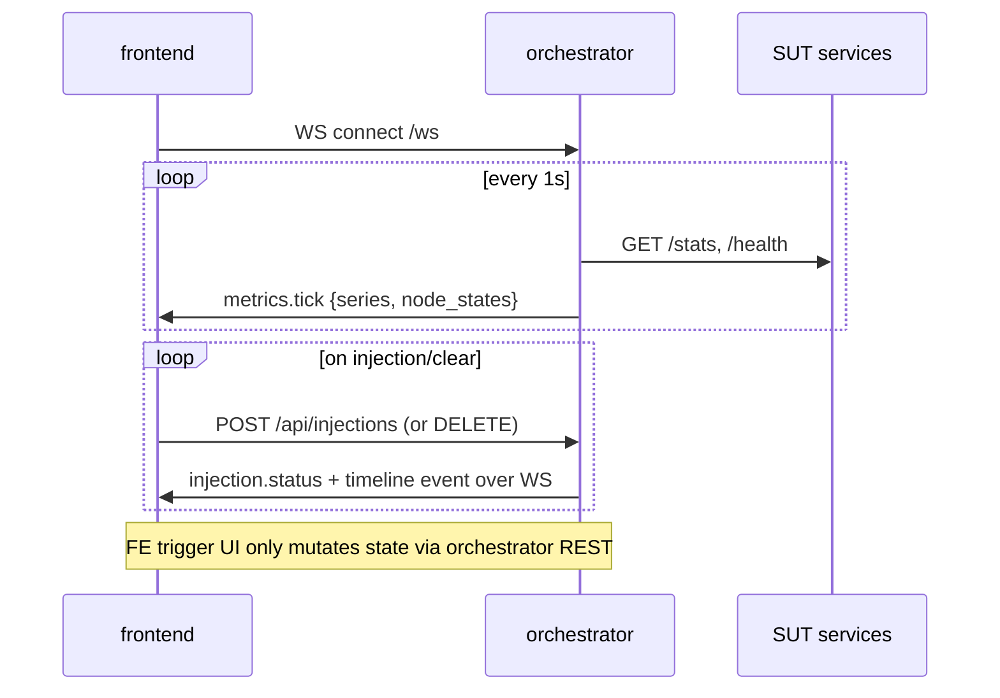

# Architecture: Failover Forge

> Companion to `docs/PRD.md` (scope) and `docs/API_SPEC.md` (contracts). This doc explains *how the pieces fit* and *how failure propagates*.
> For the plain-English implementation walkthrough (data flow, failure mechanics, code map), see [`TECHNICAL_GUIDE.md`](TECHNICAL_GUIDE.md).

## 1. High-level topology

Two planes:

- **Data plane (SUT — System Under Test):** the realistic order/checkout system. Processes real traffic. This is what breaks.
- **Control plane:** orchestrator + frontend. Generates load, injects failures, observes, records, reports. Never carries business traffic.



Notes:
- All SUT↔data-service traffic is on the internal compose network.
- Frontend talks **only** to orchestrator. No direct SUT calls (keeps live-deploy gating simple).
- inventory stock is in-memory (seeded); only orders and events persist in Postgres for MVP.

## 2. Service responsibilities

| Service | Responsibility | State owned |
|---|---|---|
| checkout-api | Create orders, read status, reserve stock, enqueue fulfillment, cache status reads | none durable (writes orders to PG, messages to RQ) |
| inventory-api | Stock lookup + reservation with simple decrement | in-memory SKU map (seeded) |
| fulfillment-worker | Consume fulfillment queue, mark orders `fulfilled`, route poison messages to DLQ | none durable (writes PG) |
| orchestrator | Load generation, failure injection, detection, event store access, aggregation, WS broadcast, reports | incident_events (PG), rollups |
| frontend | Render dashboard; trigger actions via orchestrator REST | none |

## 3. Request & message flows

### 3.1 Happy path order

```mermaid
sequenceDiagram
    participant O as orchestrator/loadgen
    participant C as checkout-api
    participant I as inventory-api
    participant R as Redis
    participant P as Postgres
    participant Q as RabbitMQ
    participant W as fulfillment-worker

    O->>C: POST /orders
    C->>I: POST /stock/{sku}/reserve
    I-->>C: 200 reserved
    C->>P: INSERT order (status=pending)
    C->>Q: publish fulfillment(order_id)
    C-->>O: 201 {order_id, status}
    Q->>W: deliver
    W->>P: UPDATE orders SET status=fulfilled
    Note over C,R: later GET /orders/{id}<br/>cache hit → Redis; miss → Postgres
```

### 3.2 Cache read-through (checkout-api)

1. `GET /orders/{id}` → check `cache:order:{id}` in Redis.
2. Hit → return (stats.cache_hit += 1).
3. Miss → read Postgres, write-through to Redis with TTL (default 60s), stats.cache_miss += 1.
4. Cache outage injection forces the miss path (and optionally simulates a timeout) — origin sees full read load.

### 3.3 Fulfillment + DLQ

- Queue `fulfillment` (durable), routing default exchange, prefetch 8.
- Message schema: JSON `{order_id, sku, qty, attempt}`.
- Worker failure handling: retry once with `attempt+1` republish; on `attempt >= 2` or poison (unparseable) → publish to `fulfillment.dlq` with reason header, ack original.
- DLQ is a first-class teaching surface: queue saturation floods make DLQ/backlog visible on the dashboard.

## 4. Control plane internals (orchestrator)



- **loadgen:** asyncio tasks paced by RPS (token/sleep scheduling); profiles are named mixes (see API_SPEC §3); every load start/stop is an event.
- **injector:** writes Redis flags with TTL; appends FAILURE_INJECTED / MITIGATION_APPLIED events; crash mode calls SUT `/admin/crash`.
- **detector:** evaluates rolling thresholds (error %, p95, queue depth, cache hit rate) against baselines; emits SYMPTOM_DETECTED / CASCADE_PROPAGATED; heuristic, not ML.
- **aggregator:** polls each service `GET /stats` (1s), computes dashboard series, pushes `metrics.tick` over WS; persists optional rollups for report generation.
- **eventstore:** sole writer/reader of `incident_events` (append-only).
- **reports:** pure function of event list + rollups → markdown report object.

## 5. Event-sourced incident timeline

### 5.1 Store schema (Postgres)

```sql
CREATE TABLE incident_events (
    id          BIGSERIAL PRIMARY KEY,          -- global order
    incident_id UUID        NOT NULL,
    seq         BIGINT      NOT NULL,           -- per-incident order, starts at 1
    event_type  TEXT        NOT NULL,
    payload     JSONB       NOT NULL DEFAULT '{}',
    ts          TIMESTAMPTZ NOT NULL DEFAULT now(),
    UNIQUE (incident_id, seq)
);
-- APPEND ONLY: no UPDATE/DELETE. Corrections are new events.
```

Incidents themselves are derived (first event opens, INCIDENT_CLOSED closes) or kept in a thin `incidents` projection table (id, opened_at, closed_at, status, title) maintained by a subscriber — allowed as a *projection*, never as source of truth.

### 5.2 Event catalog

| event_type | Emitted by | Key payload fields |
|---|---|---|
| INCIDENT_OPENED | detector / injector | `{trigger: "injection"\|"threshold"}` |
| LOAD_STARTED / LOAD_STOPPED | loadgen | `{profile, rps, duration_s}` |
| FAILURE_INJECTED | injector | `{service, failure_type, intensity, ttl_s}` |
| SYMPTOM_DETECTED | detector | `{service, metric, observed, threshold}` |
| CASCADE_PROPAGATED | detector | `{from_service, to_service, via: "http"\|"queue"\|"db"\|"cache"}` |
| DLQ_MESSAGE | worker/orchestrator poll | `{order_id, reason}` |
| MITIGATION_APPLIED | injector (clear) | `{service, failure_type}` |
| INCIDENT_CLOSED | detector | `{mttr_s, summary}` |
| REPORT_GENERATED | reports | `{report_id}` |

### 5.3 Replayability invariant

Given the event list of an incident, the post-incident report must be reconstructable with no other data source except optional rollups. Events carry enough context (intensity, observed metrics snapshots in payloads where relevant) to do this.

## 6. Failure propagation model

The blast-radius graph is a **static dependency topology** + **dynamic health state**:



Edge classes: `http` (sync, latency-sensitive), `queue` (async, buffers then lags), `db`, `cache`.

### 6.1 Propagation rules (implemented in orchestrator detector)

| Primary failure | Direct effect | Propagated effects |
|---|---|---|
| inventory-api latency/error | checkout reserve calls slow/fail | checkout error % + p95 rise; orders not created; queue under-fed |
| checkout-api latency/error/crash | client-facing failures | all traffic erroring; queue under-fed; worker idle while users see outages |
| cache outage (checkout) | all reads hit Postgres | Postgres load/latency rise; checkout p95 rise (origin stampede) |
| queue saturation | depth grows | fulfillment lag grows; GET status shows pending longer; eventually disk/memory pressure |
| worker pause (saturation assist) | no consumption | same as saturation |
| Postgres down (stretch) | all writes/reads fail | checkout + worker failures; cache may mask reads briefly |

Node states: `healthy | degraded | down | recovering`. A node is marked based on polled health + stats thresholds; when a node leaves `healthy`, edges it depends on are highlighted and downstream nodes get `degraded` (cascade) until they independently fail.

This model is intentionally **simple and explicit** — the recruiter can read the rules in this file. It does not claim accurate queueing-theory simulation.

## 7. Injection mechanics (app-level)

All injection is **fail-open** and **TTL-bounded** (default 300s) so a dead orchestrator never leaves the SUT permanently broken.

| Failure | Mechanism |
|---|---|
| Latency | Middleware reads `inj:latency:{service}` (ms); `await asyncio.sleep(ms/1000)` before/after handler |
| Error ratio | Middleware reads `inj:error:{service}` (0.0–1.0); per-request `random.random() < ratio` → 503 + `X-Injection: error` |
| Crash | `POST /admin/crash` (internal network only) → process exits; compose `restart: on-failure` restarts it |
| Queue saturation | Orchestrator publishes N synthetic fulfill messages + sets `inj:pause_worker=1` (worker stops consuming while flag set) |
| Cache outage | checkout-api reads `inj:cache_outage`; when "1", skip Redis entirely (forced misses; optional artificial cache-call timeout) |

Services never call the orchestrator. Flags are read from Redis on the request path (cheap `GET`); services cache flag values for ≤250ms to protect hot path (documented staleness bound).

## 8. Metrics & observation

- Each SUT service maintains in-process counters + fixed latency histogram buckets and exposes `GET /stats` (JSON) — contract in API_SPEC §4.
- Orchestrator polls every 1s, computes series (RPS, error %, p95 approx from buckets, queue depth from RabbitMQ management API, cache hit rate).
- Prometheus/Grafana is explicitly **not** MVP (PRD): the product story lives in one custom UI. `/stats` is scrape-shaped enough to add Prometheus later.

## 9. Dashboard data path



## 10. Deployment topology

### MVP (local)

`docker compose up --build` — 8 containers: postgres, redis, rabbitmq, checkout-api, inventory-api, fulfillment-worker, orchestrator, frontend (dev or prod build).

### Phase 5 (live) — design intent

- Frontend → Vercel (static/Next).
- Backend stack → Fly.io or Koyeb: one app with multiple processes/containers, or split SUT vs orchestrator apps; Redis + Postgres + RabbitMQ as containerized sidecars in the same Fly app (simple, free-tier friendly) — decide at Phase 5; local-first remains the source of truth.
- Injection routes require `X-Chaos-Token`; live may disable injection entirely (dashboard-only demo).

### Roadmap (not built)

- k3s/kind manifests; pod-kill failures; Chaos Mesh network experiments; circuit breakers + backpressure as toggleable mitigations.

## 11. Explicit tradeoffs (for README)

1. **App-level chaos vs infra chaos:** app-level works everywhere and teaches semantics; it cannot teach network partitions — deferred to Chaos Mesh roadmap.
2. **Custom metrics vs Prometheus:** custom keeps the story in one UI and deps light; sacrifices ecosystem tooling — acceptable for a teaching demo.
3. **In-process stats vs pull model:** `/stats` polling is simple and debuggable; less precise than a time-series DB — fine at demo RPS.
4. **In-memory inventory:** no stock-persistence story; reduces scope creep in the SUT.
5. **No circuit breakers in MVP:** cascades are ugly on purpose; Phase 2 adds the fix for narrative contrast.
6. **TTL'd Redis flags:** bounded blast radius of control-plane bugs at the cost of needing renewable injections for long incidents.
