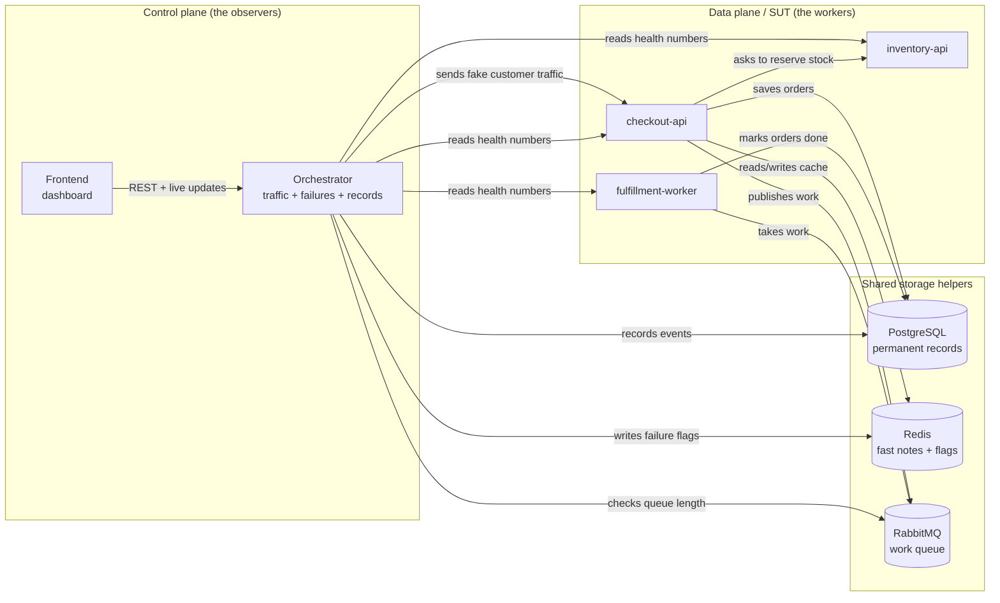
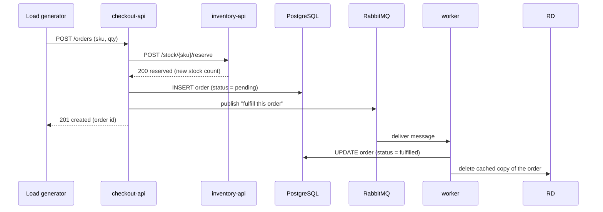

# Failover Forge — Technical Guide

### A plain-English explanation of how the system works

> **Who this is for:** anyone who wants to understand the project — you do not
> need a programming background.
>
> **How to read it:** technical terms are kept, but explained in everyday
> language when they first matter. If you forget what something means, jump to
> the [**Glossary**](#glossary) at the bottom; most bold terms are defined there.
>
> **What this guide covers:** what the pieces are, how an order travels through
> them, how the system is broken on purpose, how the dashboard knows what is
> happening, and how to run it yourself.

---

## Table of contents

1. [The 30-second version](#1-the-30-second-version)
2. [The two halves: control room and working system](#2-the-two-halves-control-room-and-working-system)
3. [Who does what](#3-who-does-what)
4. [How the pieces talk to each other](#4-how-the-pieces-talk-to-each-other)
5. [A normal order, step by step](#5-a-normal-order-step-by-step)
6. [The three storage helpers](#6-the-three-storage-helpers)
7. [Keeping the system busy](#7-keeping-the-system-busy)
8. [Breaking things on purpose](#8-breaking-things-on-purpose)
9. [Measuring health](#9-measuring-health)
10. [Incidents, timelines, and reports](#10-incidents-timelines-and-reports)
11. [The dashboard and live updates](#11-the-dashboard-and-live-updates)
12. [Running it yourself](#12-running-it-yourself)
13. [Demo playbook and troubleshooting](#13-demo-playbook-and-troubleshooting)
14. [Things that surprise people](#14-things-that-surprise-people)
15. [Where the code lives](#15-where-the-code-lives)
16. [Glossary](#glossary)

---

## 1. The 30-second version

Failover Forge is a small, pretend online shop. You can press a button to make
part of the shop slow, broken, crashed, or overloaded — on purpose — and then
watch what happens on a live dashboard.

Two things make it interesting:

1. **The failures are real.** A delay really delays requests. An error really
   returns an error. A crash really kills a process. The numbers on screen come
   from the services themselves, not from a script.
2. **Every failure is written down** in a permanent log. Later you can replay the
   story of what happened, see how long the problem lasted, and read a report
   generated from that log.

This kind of deliberate breaking is called **chaos engineering**. It is how real
teams practice for outages before an outage happens by accident.

---

## 2. The two halves: control room and working system

The project is split into two halves on purpose.

| Half | Plain meaning | What it contains |
|---|---|---|
| **Control plane** (the control room) | The part that watches, drives traffic, and causes problems | The **orchestrator** and the **frontend** dashboard |
| **Data plane** (the working system) | The part that does the actual shop work and gets broken | **checkout-api**, **inventory-api**, **fulfillment-worker** |

The working system is also called the **SUT**, short for **System Under Test**.
That is a testing term for "the thing we are examining."

**The rule:** the working system never calls the control room. The control room
can call the working system. This keeps the two halves independent, like a
flight simulator: the simulator is the SUT, and the instructor's panel is the
control plane.



---

## 3. Who does what

There are **eight containers**. A **container** is a packaged, isolated running
copy of a program — think of it as a small computer inside your computer. A tool
called **Docker Compose** starts them all together.

| Container | Plain-English job | Technical name | Address on your machine |
|---|---|---|---|
| `frontend` | The dashboard you look at and click | **frontend** | `http://localhost:3000` |
| `orchestrator` | The control room: makes traffic, breaks things, records events, serves the dashboard data | **orchestrator** | `http://localhost:8000` |
| `checkout-api` | The waiter: takes an order, checks stock, saves it, sends it to the kitchen | **checkout-api** | `http://localhost:8001` |
| `inventory-api` | The pantry: knows how many of each item are left and reserves them | **inventory-api** | `http://localhost:8002` |
| `fulfillment-worker` | The kitchen: takes queued orders and marks them fulfilled | **fulfillment-worker** | `http://localhost:8003` |
| `postgres` | The permanent ledger: keeps orders and the incident log | **PostgreSQL** database | internal only (port 5432) |
| `redis` | The fast notepad: keeps a short-lived cache and the "break this" switches | **Redis** | internal only (port 6379) |
| `rabbitmq` | The ticket rail: holds work messages until the kitchen picks them up | **RabbitMQ** message **queue** | internal, plus a control panel at `:15672` |

A **service** is just one of these long-running programs. An **API** is the set
of web addresses (called **endpoints**) a service answers.

> **Why are some addresses "internal only"?** Only the five ports above are
> opened to your computer. The database, the notepad, and the AMQP port of the
> queue are reachable only between containers, which is safer and simpler.

---

## 4. How the pieces talk to each other

There are three ways information moves:

1. **Request and response (HTTP).** One program asks another for something and
   waits for the answer. Example: checkout asks inventory to reserve an item.
   When the call is **synchronous**, the caller cannot continue until the answer
   arrives.
2. **Messages through a queue.** One program leaves a message on a rail, and
   another program picks it up later. The sender does not wait. This is
   **asynchronous** communication.
3. **Live updates (WebSocket).** The dashboard keeps one connection open and the
   orchestrator pushes new information through it as it happens. A **WebSocket**
   is a two-way connection that stays open, unlike a normal request that ends
   immediately.

**REST** is the ordinary style of web request used by the dashboard and the
services: each action is a **method** plus an address. `GET` means "read",
`POST` means "create", `DELETE` means "remove".

A few general rules used everywhere:

- Data is sent as **JSON**, a text format that looks like
  `{"sku": "SKU-1001", "qty": 1}`.
- Every order and incident gets a **UUID**, a long random identifier like
  `550e8400-e29b-41d4-a716-446655440000`, so two things never collide.
- Times are written in **UTC** (a universal clock) in **ISO-8601** format, ending
  with `Z`, for example `2026-10-20T12:00:00Z`.

---

## 5. A normal order, step by step

This is the "everything works" story. Follow the numbers.



### Step by step

1. **Traffic arrives.** The orchestrator's **load generator** sends
   `POST /orders` to checkout-api. It is pretending to be a customer.
2. **Checkout asks inventory.** Checkout calls
   `POST /stock/SKU-1001/reserve` and waits, because this call is
   synchronous. Inventory checks its list and subtracts the quantity.
3. **Possible answers.** Inventory can reply:
   - `200` — reserved, with the new count.
   - `404` — that product code does not exist.
   - `409` — not enough stock left.
   - If inventory is unreachable, checkout replies `503` ("service
     unavailable").
4. **Checkout saves the order.** It creates an order id and writes a row into
   the PostgreSQL `orders` table with status `pending`.
5. **Checkout leaves a message.** It publishes a small **JSON** message to the
   RabbitMQ queue named `fulfillment`, containing the order id, product code,
   quantity, and an attempt number starting at `0`.
6. **Checkout answers the customer.** It returns status `201` ("created") and
   the order id.
7. **The worker picks up the message.** It updates the order row to
   `fulfilled` and records the time.
8. **The cache is cleared.** The worker deletes the cached copy of that order so
   the next status read does not show stale `pending` information.
9. **Reading the order later.** `GET /orders/{id}` first checks Redis. If the
   order is there (a **cache hit**), it answers immediately. If not (a **cache
   miss**), it reads PostgreSQL and copies the answer into Redis for 60 seconds.

Order status can only become `pending` or `fulfilled`. The database allows a
`failed` value, but no code writes it in this version.

### What can go wrong on this path

| Problem | What happens |
|---|---|
| Inventory is slow | Checkout waits, so the customer waits |
| Inventory returns errors | Checkout returns `503`; no order is created |
| Inventory has no stock | Checkout returns `409`; no order is created |
| PostgreSQL is down | Checkout fails while saving |
| RabbitMQ is down at publish time | The order still returns `201` but stays `pending` forever — the publish failure is logged and ignored |
| The worker is paused | Messages pile up in the queue; orders stay `pending` until it resumes |

---

## 6. The three storage helpers

The system uses three different storage tools because they solve different
problems. This is a common pattern in real systems.

### 6.1 PostgreSQL — the permanent ledger

PostgreSQL (often shortened to **Postgres**) is a **relational database**. It
stores data in **tables**, which are like spreadsheets, with **rows** for each
record and **columns** for each field. It is asked questions using **SQL**, a
standard database language.

It keeps three tables:

| Table | What it holds | Plain analogy |
|---|---|---|
| `orders` | Every order, its product, quantity, and status | The order ledger |
| `incident_events` | The permanent, ordered list of everything that happened during incidents | The security-camera logbook |
| `incidents` | A short summary row per incident (opened, closed, title) | The index at the front of the logbook |

The `incidents` table is a **projection** — a convenience copy. The truth is
always the event table. If the two ever disagree, the event table wins.

### 6.2 Redis — the fast notepad

Redis is an **in-memory** data store. "In memory" means it keeps data in the
computer's working memory (RAM), so reading it is very fast. It is used for two
things:

1. **A cache.** A cache is a small, fast copy of data that is expensive to
   fetch. Here, an order's details are copied into Redis for 60 seconds after
   being read from Postgres. The key looks like `cache:order:{order-id}`.
   The 60-second lifetime is called a **TTL** (time to live).
2. **Failure flags.** A **flag** is a simple switch stored under a name, such as
   `inj:latency:inventory-api`. If the switch is present, the service behaves
   differently. Every failure flag also has a TTL, so it disappears on its own.

The **fail-open** rule: if a service cannot reach Redis to read a flag, it
assumes "no failure" and keeps working. A broken notepad must not break the
shop.

### 6.3 RabbitMQ — the ticket rail

RabbitMQ is a **message queue**. A **producer** leaves a message; a **consumer**
takes it. Messages wait in a named **queue** until someone is ready.

- The queue is called `fulfillment`.
- The worker takes up to 8 messages at a time. That limit is called
  **prefetch**.
- When the worker finishes, it **acknowledges** the message (sends an **ACK**),
  which tells RabbitMQ it can be forgotten.
- If the worker cannot finish, it can publish a new copy with the attempt number
  increased (a **retry**).
- After too many attempts, or if the message is malformed (a **poison
  message**), it is moved to a **dead-letter queue** (DLQ) named
  `fulfillment.dlq`. Think of a DLQ as the "problems" tray: nothing is thrown
  away; it is set aside for inspection.
- The worker also deletes the cached order after fulfilling it. That is a
  **write-invalidation** — removing an outdated copy so nobody reads stale data.

---

## 7. Keeping the system busy

The **load generator** is the part of the orchestrator that pretends to be
customers. Without traffic, nothing interesting happens.

| Setting | Meaning |
|---|---|
| **RPS** (requests per second) | How many requests are sent each second |
| **Duration** | How long the run lasts |
| **Profile** | What mix of requests to send |

There are three **profiles**:

| Profile | Mix |
|---|---|
| `mixed` | About 70% reads (`GET /orders/{id}`) and 30% writes (`POST /orders`) |
| `write` | 100% new orders |
| `read` | 100% status reads |

The generator paces itself against an absolute clock, so 10 RPS for 30 seconds
means 300 request slots even if some requests are slow. It does not send all
requests at once: it waits for each request to finish before starting the next
slot. In practice that means a very slow system also lowers the achieved RPS.

Until at least one order has been created in a run, read requests have no id to
ask for, so they fall back to creating an order. That keeps traffic flowing.

Only one load run can exist at a time. Starting a second one returns
`409 Conflict`.

---

## 8. Breaking things on purpose

### 8.1 What "injection" means

An **injection** is a deliberate fault added to a running system. The
orchestrator does not edit the code or stop the container (except for the crash
case). Instead, it writes a flag into Redis. Each service checks its flags while
handling requests. If a flag is present, the service changes its behavior.

This is called **application-level chaos**: the fault is simulated by the
application itself, not by the network or the operating system. It has the big
advantage of working anywhere Docker runs. It cannot simulate a real network
partition — the project's documentation lists that as a future idea.

### 8.2 The five kinds of failure

| Failure | What it does | Where the switch lives | What you see | How it ends |
|---|---|---|---|---|
| **Latency** | Adds a delay to every request, in milliseconds | `inj:latency:{service}` | p95 latency rises; callers wait longer | Clear it, or TTL expires |
| **Error** | Randomly fails a percentage of requests with `503` | `inj:error:{service}` | Error rate rises; dashboard shows red | Clear it, or TTL expires |
| **Crash** | Tells the service to kill itself | No flag; a one-time web call | Connection refused, then a restart | Docker restarts the container automatically |
| **Queue saturation** | Floods the queue with fake messages, then pauses the worker | `inj:pause_worker` | Queue depth climbs; orders lag | Clear it; worker resumes |
| **Cache outage** | Makes checkout skip Redis entirely | `inj:cache_outage` | Cache hit rate falls; Postgres reads rise | Clear it, or TTL expires |

Some rules the system enforces:

- **Cache outage only works on checkout-api**, because that is the only service
  that uses the cache.
- **Queue saturation only works on the worker**, because that is the consumer.
- **Latency and error on the worker are accepted but do nothing.** The worker has
  no per-request path to slow down or fail; only the pause flag matters there.
- The default TTL is 300 seconds; the maximum is 3600 seconds.
- Latency must be between 1 and 10,000 ms. Error ratio must be between 0 and 1.
  Flood size must be between 1 and 5,000 messages.

### 8.3 Crash, specifically

Checkout, inventory, and the worker each have a special address,
`/admin/crash`. Calling it schedules the program to exit with an error code
50 milliseconds later. The short delay lets the reply `{"ok": true}` reach the
caller first.

Docker Compose is configured with `restart: on-failure`, which means: if the
program exits with an error, start it again. So a crash looks like a brief gap
where requests fail, followed by an automatic recovery.

Because a crash leaves nothing in Redis, "clearing" a crash injection does
nothing to the service. It only removes the injection from the active list and
writes a mitigation event.

### 8.4 The three safety rules of injection

1. **Every flag expires.** Even if the orchestrator dies, the working system
   cannot stay broken forever.
2. **Flag reading fails open.** If Redis is unreachable, the service assumes no
   failure.
3. **Flags are cached for 250 milliseconds inside each service.** This protects
   the fast path from asking Redis on every single request. The side effect is
   that an injection or a clear can take up to a quarter-second to be noticed.

### 8.5 One incident at a time

The orchestrator allows only one **incident** (an outage story) to be open at a
time. The first injection, or the first metric that crosses a danger threshold,
opens it. Everything after that is attached to the same incident until it closes.

---

## 9. Measuring health

Every service keeps its own counters. The orchestrator asks each service for
those counters once per second. This asking is called **polling**, and each
one-second round is called a **tick**.

### 9.1 What each service counts

- How many requests it has handled in total (`requests_total`).
- How many of those were errors (`requests_error`). Only replies of status 500
  or higher count as errors here; a 404 or 409 does not.
- How many requests are in progress right now (`in_flight`).
- A **latency histogram**: a set of buckets that counts how many requests
  finished within each time range. The buckets are 0, 5, 10, 25, 50, 100, 250,
  500, 1000, 2500, and 5000 milliseconds.
- Service-specific numbers: checkout counts cache hits, cache misses, and
  published messages; the worker counts consumed, acknowledged, retried, and
  dead-lettered messages, and whether it is paused.

The `/stats` address returns these numbers as JSON. The `/health` address returns
a simple "ok". Health and stats requests themselves are not counted, so polling
does not inflate the numbers.

### 9.2 Turning totals into per-second numbers

The counters only ever go up. To get a rate, the orchestrator subtracts the
previous tick's value from the current one:

```
requests this second = current total − previous total
RPS = requests this second ÷ seconds elapsed
error rate = errors this second ÷ requests this second
```

If a service restarts, its counters start from zero. The orchestrator handles
this as a fresh baseline, which can cause one odd-looking tick.

### 9.3 What "p95 latency" means

**p95** is the 95th percentile: the time within which 95 out of 100 requests
finish. If p95 is 400 ms, then 95% of requests were faster than about 400 ms,
and the slowest 5% were slower. It is more useful than an average because a few
very slow requests can hide inside an average.

In this project, p95 is **approximate**. The system finds which histogram bucket
contains the 95th percentile and reports that bucket's upper edge. A true value of
48 ms and a true value of 49 ms can both show up as 50 ms.

### 9.4 Node states

The orchestrator labels each service:

| State | Meaning |
|---|---|
| `healthy` | Responding and within normal ranges |
| `degraded` | Responding, but with too many errors or very high latency |
| `down` | The health or stats request failed |
| `recovering` | It was down and is now responding normally again |

A service is labeled `degraded` when more than 20% of its requests are errors or
its p95 is above 1500 ms. It is labeled `down` when the orchestrator cannot get
its stats at all. This state is what colors the graph.

### 9.5 Cache and queue numbers

- **Cache hit rate** = hits ÷ (hits + misses). During a cache outage it falls
  toward zero.
- **Queue depth** = how many messages are waiting. It is read from RabbitMQ's
  management API, which is a web interface for inspecting the queue.
- **DLQ depth** = how many problem messages are in the dead-letter queue.

### 9.6 Where the history lives

The orchestrator keeps the last 900 ticks (about 15 minutes) in memory for the
charts. It does not save this history to a database. After a restart, the charts
start empty. Reports still work because they are built from the permanent event
log, not from these charts.

---

## 10. Incidents, timelines, and reports

### 10.1 What opens and closes an incident

An **incident** is one continuous outage story. It has two possible triggers:

1. **An injection.** As soon as you inject any failure, an incident opens. Its
   title is something like "latency on inventory-api".
2. **A threshold breach.** Even without an injection, the detector can open an
   incident if a metric crosses a danger line.

The danger lines are:

| Metric | Danger line |
|---|---|
| Error rate | More than 20% |
| p95 latency | More than 1000 ms |
| Queue depth | More than 100 messages |

The **detector** checks these once per tick. It does not report the same metric
more than once every 10 seconds, to avoid flooding the log.

Closing works differently depending on the trigger:

- An **injection incident** closes when all active injections are cleared.
- A **threshold incident** closes when every metric is back below its line and
  no injections are active.

That is the "close on clear and healthy" rule.

### 10.2 The event log is append-only

An **event** is a recorded fact: "this happened at this time." The event table is
**append-only**, meaning rows are only added. Nothing is ever edited or deleted.
If a correction is needed, a new event is added.

This is called **event sourcing**. Instead of storing only the final state, the
system stores the full sequence of things that happened. That makes the story
replayable.

Each incident has its own sequence number, starting at 1. The global `id`
column preserves overall order across all incidents. A unique rule
(`UNIQUE (incident_id, seq)`) prevents duplicate sequence numbers within one
incident.

### 10.3 What gets recorded

| Event | Meaning |
|---|---|
| `INCIDENT_OPENED` | An incident started, and why (`injection` or `threshold`) |
| `FAILURE_INJECTED` | A fault was switched on, with its service and intensity |
| `SYMPTOM_DETECTED` | A metric crossed a danger line, with the observed value |
| `MITIGATION_APPLIED` | A fault was cleared |
| `LOAD_STARTED` / `LOAD_STOPPED` | Traffic generation started or stopped |
| `INCIDENT_CLOSED` | The incident ended, with **MTTR** and a summary |

These events are also pushed live to the dashboard over the WebSocket.

Two event types mentioned in the design document are **not** emitted by the
current code: `CASCADE_PROPAGATED` and `DLQ_MESSAGE`. DLQ visibility comes from
polling RabbitMQ instead. `REPORT_GENERATED` is also not stored, because reports
are generated when you ask for them.

There is also a special **ambient stream** for load start/stop events that happen
while no incident is open. It uses the all-zero UUID
`00000000-0000-0000-0000-000000000000` and is deliberately hidden from the
incident list. It is a parking place, not a real incident.

### 10.4 The report

The report answers four questions:

| Part | Meaning |
|---|---|
| **Root cause** | Which service and failure started it. It uses the first injected failure; if there was none, the first detected symptom |
| **Blast radius** | Which services appear in the events. This is a list derived from the log, not a graph calculation |
| **Timeline** | Every event in order, with its details |
| **MTTR** | Mean time to recovery — the time from opening to closing the incident |

The **replayability rule** is important: the report is generated from the event
log alone. It does not look at live charts or current state. If the events are
there, the story can be reconstructed.

### 10.5 Why "blast radius" is only a list

It is tempting to think the blast radius is calculated by following arrows in
the graph. It is not. `reports.py` simply collects every service name mentioned
in an event. The colored graph on screen is a separate, visual aid. This
distinction matters if you are reading the code: changing the topology will not
change the report.

---

## 11. The dashboard and live updates

The dashboard has three pages:

| Page | Address | Shows |
|---|---|---|
| Dashboard | `/` | Live graph, metric tiles, charts, failure buttons, queue panel |
| Incidents | `/incidents` | List of every incident |
| Incident detail | `/incidents/{id}` | The report and the full timeline for one incident |

### 11.1 What the dashboard receives

The frontend opens one WebSocket connection to the orchestrator. The orchestrator
sends five kinds of message:

| Message | When | Contains |
|---|---|---|
| `metrics.tick` | About once per second | All service rates, p95, cache, queue, node states |
| `queue.update` | With every tick | Queue depth and DLQ depth |
| `injection.status` | When a failure is added or cleared | The current list of active injections |
| `incident.status` | When an incident opens or closes | Its id and status |
| `timeline.event` | Whenever an event is recorded | The event itself |

The dashboard does not guess or invent numbers. Every chart value comes from a
service's own counters, passed through the orchestrator.

### 11.2 If the connection drops

The frontend reconnects automatically. It waits 1 second, then 2, 4, 8, and so
on, up to 30 seconds. This growing wait is called **exponential backoff**. After
a successful reconnect, it re-fetches the latest REST state so it does not miss
anything that happened while it was disconnected.

### 11.3 The graph

The graph is drawn as plain SVG (scalable vector graphics — shapes described in
text, not a picture file). It has six nodes and six arrows. Node color comes from
the latest state. An arrow is highlighted only when **both** ends are unhealthy.
That highlight is a visual rule, not a simulation of how failure travels.

The frontend is built with **Next.js**, a framework for building web
applications; **React**, a library for building screens from components; and
**TypeScript**, a stricter version of JavaScript that catches type mistakes
before the code runs. Charts use a library called **recharts**.

---

## 12. Running it yourself

### 12.1 What you need

- **Docker** with **Docker Compose**. Docker runs the containers; Compose starts
  the whole set from one file.
- About 2 GB of free memory and a free port 3000, 8000, 8001, 8002, 8003, and
  15672.
- `curl` (a command-line web request tool) and `python3` if you want to run the
  helper scripts exactly as written.
- `uv` and Node.js/npm only if you want to run the code checks (`make test`,
  `make lint`, `make frontend`) on your own machine; running the application
  itself only needs Docker.

### 12.2 First start

```bash
cp .env.example .env
docker compose up --build -d
```

Then open <http://localhost:3000>.

The `-d` means "detached": the containers keep running in the background. The
first build takes one to two minutes. **Environment variables** are settings
passed into containers; `.env` holds the defaults such as database passwords and
the chaos token.

### 12.3 Useful commands

| Command | What it does |
|---|---|
| `make up` | Same as `docker compose up --build -d` |
| `make ps` | List the containers and their state |
| `make logs` | Follow the logs (the running text output) of all containers |
| `./scripts/smoke.sh` | End-to-end check: create an order, wait until it is fulfilled |
| `./scripts/seed.sh` | Reset inventory stock to the default amounts |
| `make test` | Run the automated tests for all Python services |
| `make lint` | Check code style and types |
| `make frontend` | Install, lint, type-check, and build the frontend |
| `make verify` | Run every check at once |
| `docker compose down -v` | Stop everything and **delete the database volume** |

A **volume** is storage that survives a container restart. The `-v` flag removes
it, so orders and incidents are wiped.

### 12.4 Addresses to remember

| Address | What it is |
|---|---|
| `http://localhost:3000` | Dashboard |
| `http://localhost:8000` | Orchestrator API |
| `http://localhost:8000/ws` | Live updates (WebSocket) |
| `http://localhost:8001/health` | Checkout health |
| `http://localhost:8002/health` | Inventory health |
| `http://localhost:8003/health` | Worker health |
| `http://localhost:15672` | RabbitMQ management panel (user/password `forge`/`forge`, from `.env`) |

### 12.5 A quick manual test

```bash
# Reset stock
curl -X POST http://localhost:8002/admin/seed

# Create an order
curl -X POST http://localhost:8001/orders \
  -H 'Content-Type: application/json' \
  -d '{"sku":"SKU-1001","qty":1,"customer_ref":"me"}'

# Read the order using the id from the previous answer
curl http://localhost:8001/orders/<order-id>
```

The read response has an `X-Cache` **header** (extra metadata attached to a web
response) that says `hit` or `miss`, so you can see the cache working.

---

## 13. Demo playbook and troubleshooting

### 13.1 The 60-second demo

1. Open the dashboard.
2. Start load: `POST /api/load` with 10 RPS for 30 seconds, or use the UI.
3. Inject **latency** on `inventory-api` at 2000 ms.
4. Watch p95 rise past the degradation line, the inventory and checkout nodes
   change color, and the `inventory → checkout` arrow highlight.
5. Inject **cache outage** on `checkout-api`. Watch the cache hit rate fall and
   the Postgres reads rise.
6. Inject **queue saturation** on `fulfillment-worker` with 300 messages. Watch
   queue depth climb.
7. Click **Clear all**. Watch the incident close.
8. Open **Incidents → the incident** and read the generated report.

### 13.2 Changing things from the terminal

```bash
# Latency: 400 ms on inventory for 5 minutes
curl -X POST http://localhost:8000/api/injections \
  -H 'Content-Type: application/json' \
  -d '{"service":"inventory-api","failure_type":"latency","intensity":400,"ttl_s":300}'

# Errors: 50% on checkout
curl -X POST http://localhost:8000/api/injections \
  -H 'Content-Type: application/json' \
  -d '{"service":"checkout-api","failure_type":"error","intensity":0.5,"ttl_s":120}'

# Crash checkout
curl -X POST http://localhost:8000/api/injections \
  -H 'Content-Type: application/json' \
  -d '{"service":"checkout-api","failure_type":"crash","intensity":0}'

# Cache outage
curl -X POST http://localhost:8000/api/injections \
  -H 'Content-Type: application/json' \
  -d '{"service":"checkout-api","failure_type":"cache_outage","intensity":0,"ttl_s":120}'

# Queue saturation: 500 fake messages, then pause the worker
curl -X POST http://localhost:8000/api/injections \
  -H 'Content-Type: application/json' \
  -d '{"service":"fulfillment-worker","failure_type":"queue_saturation","intensity":500,"ttl_s":120}'

# See what is active
curl http://localhost:8000/api/injections

# Clear one, or clear everything
curl -X DELETE http://localhost:8000/api/injections/<injection-id>
curl -X DELETE http://localhost:8000/api/injections

# Start, inspect, and stop load
curl -X POST http://localhost:8000/api/load \
  -H 'Content-Type: application/json' \
  -d '{"profile":"mixed","rps":10,"duration_s":30}'
curl http://localhost:8000/api/load
curl -X POST http://localhost:8000/api/load/stop
```

If the setting `REQUIRE_CHAOS_TOKEN=true` is enabled, every change request also
needs the header `X-Chaos-Token: dev-token`. This **token** is a shared password.
It is off by default locally.

### 13.3 Where to look when something is wrong

| Question | Command or place |
|---|---|
| Are the containers running? | `docker compose ps` |
| What are the services saying? | `docker compose logs -f --tail=100` |
| What raw numbers does a service report? | `curl localhost:8001/stats` (or 8002 / 8003) |
| What is the orchestrator's latest summary? | `curl localhost:8000/api/metrics/latest` |
| What failures are active? | `curl localhost:8000/api/injections` |
| How full is the queue? | `curl localhost:8000/api/queue` |
| What incidents exist? | `curl localhost:8000/api/incidents` |
| What happened in one incident? | `curl localhost:8000/api/incidents/<id>` |
| What does the report say? | `curl localhost:8000/api/incidents/<id>/report` |
| What is in the event table? | `docker compose exec postgres psql -U forge -d forge -c "select * from incident_events order by id desc limit 20;"` |
| Who can log into the broker? | `docker compose exec rabbitmq rabbitmqctl list_users` (expect `forge`, tagged administrator) |

Common symptoms:

- **"Waiting for orchestrator topology…"** — the orchestrator is not reachable on
  port 8000. A likely cause is the orchestrator failing to connect to RabbitMQ at
  startup: `docker compose logs orchestrator | grep "amqp connect failed"`.
- **"user 'forge' - invalid credentials" in the broker logs** — the broker data
  directory was created before `.env` existed (or with different values). Run
  `docker compose down -v && docker compose up -d` so the broker re-seeds its user.
- **Queue panel shows `–` and `/api/queue` returns 503** — the management API is
  unreachable or the credentials in `RABBITMQ_MGMT_URL` do not match the broker
  user; check `curl -s localhost:8000/api/queue` and the `rabbitmq` node color.
- **`/api/metrics/latest` returns 503 "metrics not ready yet"** — the first
  one-second tick has not finished, or every stats poll is failing.
- **Orders stay `pending`** — look at the worker logs, queue depth, and the DLQ.
  Also check whether checkout logged a publish failure.
- **Trigger buttons return 403** — the chaos token is required, and the dashboard
  does not send one.
- **The injected delay is not visible yet** — wait up to 250 ms for the local flag
  cache, and check `/stats` for `injections_active`.

---

## 14. Things that surprise people

These are real behaviors of the current version. They are either deliberate
simplifications or small tradeoffs — not hidden bugs.

1. **Restarting the orchestrator forgets the active injection list.** The flags
   remain in Redis until their TTL runs out, so the working system can still be
   broken while the dashboard shows nothing. Clear them or wait.
2. **An open incident is not recovered after an orchestrator restart.** Its row
   stays "open" with no closing event, and a new incident can start later.
3. **Expired flags and the active list can disagree.** The orchestrator does not
   remove an injection when its flag expires. `/api/injections` may list a fault
   that is no longer happening.
4. **A newly injected fault can take up to 250 ms to start.** The same applies to
   clearing it.
5. **p95 is approximate, and very slow requests can be invisible.** The histogram
   stops at 5000 ms. A delay of 6–10 seconds is counted but not placed in any
   bucket, so it may not show up in p95.
6. **The first tick after the orchestrator starts can show a fake RPS spike.**
   It compares lifetime counters against a one-second window.
7. **A crashed service disappears from the metric list.** The detector cannot
   evaluate metrics it cannot fetch, so a crash produces "failure injected" and
   "mitigation" events but no "symptom detected" event.
8. **Stock can be reserved without an order.** Checkout reserves first, then saves
   the order. If saving fails, the stock is not returned.
9. **Reserving stock is not idempotent.** Repeating the same request reserves
   twice. There is no "do this only once" key.
10. **Queue flooding does not create dead letters.** Flood messages are
    well-formed and refer to fake orders; the database update simply affects zero
    rows, so they are accepted. To see the DLQ, send a malformed message or a
    message that keeps failing.
11. **All queue-saturation injections share one pause switch.** The worker only
    resumes when the last of them is cleared.
12. **"Clear all" can close an incident even if metrics are still bad.** Injection
    incidents close on clear, regardless of thresholds.
13. **Postgres and Redis always look healthy on the graph.** The orchestrator
    never health-checks them directly; their problems show up indirectly through
    service errors.
14. **A paused worker is still "healthy."** Pausing stops consumption; it does not
    stop the process. The `/health` response has a separate `paused` field.
15. **The dashboard has no chaos-token support.** If you turn the token on, the
    dashboard becomes read-only in practice; use `curl` for changes.
16. **The local admin addresses are not firewalled.** Because each service's whole
    port is published, `/admin/crash` and `/admin/seed` are reachable from your
    machine even though the documentation describes them as internal. They are
    not protected by the chaos token.
17. **The chart history is not saved.** Restart the orchestrator and the charts
    start over. The permanent log is unaffected.
18. **One incident at a time.** Two separate problems in quick succession are
    recorded under the same incident.

---

## 15. Where the code lives

You do not need this section to use the project. It is here for when you want to
read or change the code.

```text
FailoverForge/
├── docker-compose.yml            # starts all eight containers
├── .env.example                  # the settings template
├── Makefile                      # shortcuts for common commands
├── db/init/001_schema.sql        # creates the three database tables
├── scripts/
│   ├── smoke.sh                  # end-to-end order test
│   └── seed.sh                   # resets inventory stock
├── services/
│   ├── checkout-api/app/         # orders, cache, queue publishing
│   ├── inventory-api/app/        # in-memory stock and reservations
│   ├── fulfillment-worker/app/   # queue consumer, retries, DLQ
│   └── orchestrator/app/         # control room:
│       ├── loadgen.py            #   generates traffic
│       ├── injector.py           #   turns failures on and off
│       ├── aggregator.py         #   polls health numbers
│       ├── detector.py           #   notices danger thresholds
│       ├── eventstore.py         #   append-only incident log
│       ├── reports.py            #   builds the markdown report
│       ├── ws.py                 #   live WebSocket updates
│       └── routers/              #   web addresses the dashboard calls
├── frontend/src/
│   ├── app/                      # dashboard, incident list, incident detail
│   ├── components/               # graph, charts, buttons, timeline, report
│   └── lib/                      # API client, WebSocket client, types
└── docs/
    ├── PRD.md                    # scope and phases
    ├── ARCHITECTURE.md           # design intent
    ├── API_SPEC.md               # exact request and response shapes
    ├── USER_GUIDE.md             # step-by-step walkthrough
    └── TECHNICAL_GUIDE.md        # this file
```

A few conventions worth knowing:

- **Python services** use **FastAPI**, a web framework; **uv**, a package
  manager; **pytest**, a testing tool; **ruff**, a style checker; and **mypy**,
  a type checker.
- **JavaScript/TypeScript** code uses **npm**, the Node package manager.
- Each Python service has its own `pyproject.toml` (its dependency list) and
  `tests/` folder.
- The four Python applications follow the same shape: `main.py` starts the
  program, `config.py` reads settings, `stats.py` holds counters, and
  `injection.py` reads failure flags.

---

## Glossary

Every term used above, in alphabetical order. Definitions are written for a
reader who is new to the topic.

**201, 404, 409, 500, 503 (HTTP status codes)** — Three-digit numbers in a web
reply. `200`/`201` mean success. `404` means "not found". `409` means "conflict"
(for example, not enough stock). `500` means the server had an internal error.
`503` means "service unavailable".

**ACK (acknowledgement)** — A message telling the queue that a piece of work is
finished and can be forgotten.

**Aggregator** — The orchestrator component that polls every service's `/stats`
once per second, turns totals into rates, and builds the dashboard's tick.

**Ambient stream** — A hidden parking place in the event log for load start/stop
events that happen when no incident is open.

**API (Application Programming Interface)** — A defined set of addresses and rules
one program uses to talk to another.

**Append-only** — A log that only ever gets new rows. Nothing is edited or
deleted.

**Application-level chaos** — Faults simulated inside the application (by reading
flags) rather than by breaking the network or the machine. It is portable and
easy to control, but cannot emulate a real network partition.

**Asynchronous** — "Send it and continue." The sender does not wait for the
receiver to finish. A message queue is asynchronous.

**Backoff (exponential)** — Waiting longer after each failed reconnect: 1 s, 2 s,
4 s, and so on, up to a limit. It avoids hammering a server that is already
struggling.

**Blast radius** — The set of services affected by an incident. In this project's
report it is a list of service names found in the event log.

**Broadcast** — Sending the same message to every connected client at once.

**Bucket (histogram bucket)** — A time range used to count requests, for example
"between 250 and 500 ms". Buckets let the system estimate percentiles without
storing every individual time.

**Cache** — A small, fast copy of data that is slow or expensive to fetch from its
original source. Here, Redis holds order copies for 60 seconds.

**Cache hit / cache miss** — A hit means the requested data was already in the
cache. A miss means it was not and had to be fetched from the original source.

**Cache hit rate** — The share of cache lookups that were hits: hits ÷ (hits +
misses). A high rate means the cache is doing its job.

**Cache outage** — A failure type that makes checkout skip Redis entirely, so
every read goes to PostgreSQL and the hit rate falls.

**Chaos engineering** — Deliberately introducing failures in a controlled way to
learn how a system behaves and to practice recovery.

**Circuit breaker** — A pattern that stops calling a failing dependency to prevent
cascading failure. It is **not** used in this project; the documentation lists it
as a future idea.

**Consumer** — A program that takes messages from a queue. The worker is the
consumer here.

**Container** — A packaged, isolated running program with its own files and
network identity. Docker runs containers.

**Control plane** — The observing and controlling half of the system: the
orchestrator and the dashboard. It does not carry normal shop traffic.

**Counter** — A number that only goes up, such as "total requests handled". Rates
are calculated by comparing two counter readings.

**Crash injection** — Asking a service to kill itself so that its container
restarts. It uses a special web address, not a Redis flag.

**Data plane** — The working half of the system that does the real shop work and
gets broken. Also called the SUT.

**Database** — A program for storing and querying structured data. This project
uses PostgreSQL.

**Dead-letter queue (DLQ)** — A separate queue for messages that could not be
processed, kept for inspection instead of being lost.

**Detector** — The orchestrator component that watches metrics and opens an
incident when a danger threshold is crossed.

**DLQ depth** — The number of problem messages currently sitting in the
dead-letter queue.

**Docker / Docker Compose** — Docker packages and runs containers. Compose starts
a whole group of containers from one configuration file.

**Duration** — How long a load test runs, measured in seconds.

**Edge (graph)** — An arrow between two nodes in the dashboard graph, representing
a dependency or data flow.

**Endpoint** — A specific web address a service answers, such as `/orders`.

**Environment variable** — A named setting provided to a program from outside its
code, such as a database address or password.

**Event** — A recorded fact with a type, a time, and details: "a failure was
injected at 12:00".

**Event sourcing** — Storing the full sequence of events instead of only the
current state, so history can be replayed.

**Fail-open** — On error, choose the safe default that keeps the system running.
Here, if a failure flag cannot be read, the service assumes there is no failure.

**FastAPI** — A Python framework for building web services.

**Flag** — A simple switch stored in Redis. Its presence changes a service's
behavior.

**Frontend** — The part of the software a person sees and clicks: the dashboard.

**Health check** — A small request that answers "are you alive?" Used by Docker
and by the orchestrator.

**Header** — Extra metadata attached to a web request or response, such as
`X-Cache: hit`.

**Histogram** — A set of counters organized into ranges, used to summarize how
long requests take.

**HTTP (HyperText Transfer Protocol)** — The standard language of web requests
and responses.

**Idempotent** — Safe to repeat without changing the result a second time. This
project's stock reservation is **not** idempotent.

**In-memory** — Stored in the computer's working memory (RAM) rather than on disk.
Fast, but usually lost when the program stops.

**Incident** — One continuous outage story, from opening to closing, with its own
event timeline.

**Injection** — A deliberately introduced fault in a running system.

**Injection incident** — An incident opened because a fault was injected. It
closes when the active injections are cleared.

**ISO-8601** — A standard way to write dates and times, for example
`2026-10-20T12:00:00Z`.

**JavaScript** — The programming language that runs in web browsers; TypeScript
is a stricter version of it.

**JSON (JavaScript Object Notation)** — A plain-text format for structured data,
such as `{"sku": "SKU-1001", "qty": 1}`.

**Latency** — The time a request takes to complete.

**Load generator** — A program that sends fake customer traffic at a chosen rate.

**Log** — The running text output a program prints, useful for diagnosis.

**Markdown** — A simple text formatting language using `#` for headings and `-`
for bullets. Reports are written in it and rendered on the incident page.

**Message queue** — A holding area where one program leaves work and another picks
it up later.

**Metric** — A number that describes system behavior, such as requests per second
or error rate.

**Metrics tick** — One one-second round of collecting and summarizing metrics.

**Middleware** — Code that runs around every request, before and after the main
handler. Here it applies failures and records statistics.

**MTTR (Mean Time To Recovery)** — How long it took from an incident opening to it
closing.

**mypy** — A tool that checks Python type hints for mistakes before the program
runs.

**Next.js** — A framework for building web applications with React.

**npm** — The Node package manager, used to install the frontend's libraries.

**Node (graph)** — A box in the dashboard graph representing a service or a
storage helper.

**Orchestrator** — The control-room program that generates traffic, injects
failures, polls metrics, records events, and serves data to the dashboard.

**p95 (95th percentile)** — The value below which 95% of measurements fall. Used
to describe the slow tail of request times.

**Payload** — The useful contents of a message or event, apart from its type and
time.

**Poison message** — A message that can never be processed successfully, often
because it is malformed. It is moved to the DLQ.

**Poll / polling** — Repeatedly asking a service for its current state instead of
the service pushing updates.

**Port** — A numbered channel on a computer through which network traffic enters.
`localhost:8000` means port 8000 on your own machine.

**PostgreSQL (Postgres)** — A relational database that stores data in tables. It
holds orders, events, and incident summaries here.

**Prefetch** — The maximum number of unacknowledged messages a consumer will take
at once. Here it is 8.

**Producer** — A program that puts messages into a queue.

**Profile** — A named traffic mix for the load generator (`mixed`, `write`,
`read`).

**Projection** — A derived, convenient copy of data whose source of truth is
somewhere else. The `incidents` table is a projection of incident events.

**pytest** — The testing tool used for the Python services.

**Python** — The programming language used for all backend services here.

**Queue depth** — The number of messages waiting in a queue.

**Queue saturation** — A failure type that floods the queue with fake messages and
pauses the worker, making real orders wait.

**RabbitMQ** — The message-queue program used to pass fulfillment work from
checkout to the worker.

**React** — A JavaScript library for building user interfaces from reusable
components.

**Recharts** — A charting library for React, used for the dashboard graphs.

**Redis** — A fast in-memory data store used here for caching and failure flags.

**Relational database** — A database organized into tables with rows and columns.

**Replayability** — The ability to reconstruct what happened from stored events
alone.

**Request / response** — A request is a program asking for something; a response
is the answer.

**REST (Representational State Transfer)** — A common style of web API where each
address represents a resource and HTTP methods (`GET`, `POST`, `DELETE`) describe
the action.

**Retry** — Trying a failed operation again, here by publishing a new message with
a higher attempt number.

**Root cause** — The original fault that started an incident, as opposed to its
later symptoms.

**Row** — One record in a database table.

**ruff** — A fast Python tool that checks code style and formatting.

**RPS (requests per second)** — A rate: how many requests are handled or sent in
one second.

**Service** — One long-running program in the system, such as checkout-api.

**SQL (Structured Query Language)** — The language used to read and write data in
a relational database.

**Status code** — See "201, 404, …".

**SUT (System Under Test)** — The working system being tested and broken: the
three shop services and their storage helpers.

**SVG (Scalable Vector Graphics)** — A way to draw shapes using text, so the image
stays sharp at any size. The topology graph is drawn this way.

**Synchronous** — "Ask and wait." The caller cannot continue until the answer
arrives. Checkout's stock reservation is synchronous.

**Table** — A set of data in a database, organized into rows and columns.

**Threshold** — A danger line. Crossing it can open an incident or change a node's
state.

**Threshold incident** — An incident opened by a metric crossing a danger line
rather than by an injection. It closes when all metrics are back to normal.

**Tick** — See "metrics tick".

**Token (chaos token)** — A shared secret password that can gate the endpoints
which change the system.

**Topology** — The map of which service connects to which.

**TTL (Time To Live)** — How long a stored value or flag remains before it expires
automatically. Order cache: 60 seconds. Failure flags: 300 seconds by default.

**TypeScript** — A stricter version of JavaScript that checks types before
running. The frontend uses it.

**UTC (Coordinated Universal Time)** — A common world time standard used for all
timestamps.

**UUID (Universally Unique Identifier)** — A long random identifier, such as
`550e8400-e29b-41d4-a716-446655440000`, used so records never collide.

**uv** — A Python package and environment manager used to install each service's
dependencies.

**Volume** — Docker-managed storage that survives container restarts. The Postgres
data lives in one.

**WebSocket** — A connection that stays open so the server can push updates to the
browser immediately.

**Worker** — A background program that processes queued work. Here,
`fulfillment-worker` marks orders fulfilled.

**Write-invalidation** — Deleting or updating a cached copy when the real data
changes, so readers do not get stale information.

**YAML** — A human-readable configuration format. `docker-compose.yml` is written
in it.
