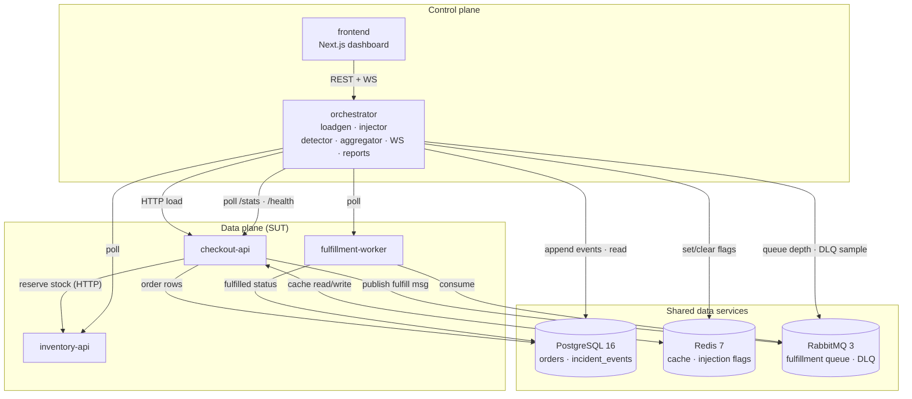
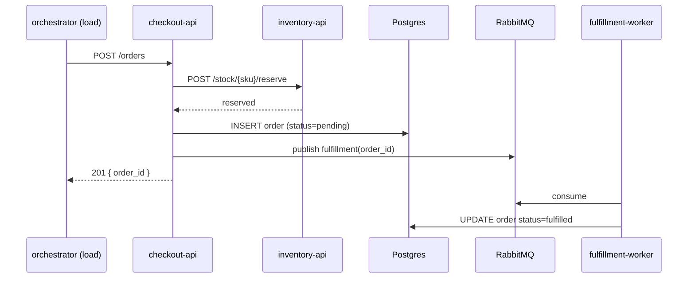

# Failover Forge — User Guide

A complete, step-by-step walkthrough: what this project is, how to run it, how to
break it, and what to watch. No prior chaos-engineering experience needed.

> Just want the short version? See [`../README.md`](../README.md). This guide is
> the deep companion: the big picture first, then a runbook you can follow line
> by line.

---

## Table of contents

1. [The big picture](#1-the-big-picture)
2. [What you need before starting](#2-what-you-need-before-starting)
3. [Step-by-step: get it running](#3-step-by-step-get-it-running)
4. [Tour of the dashboard](#4-tour-of-the-dashboard)
5. [Step-by-step: the 60-second demo](#5-step-by-step-the-60-second-demo)
6. [Step-by-step: the same thing from the terminal](#6-step-by-step-the-same-thing-from-the-terminal)
7. [Reference tables](#7-reference-tables)
8. [Troubleshooting / FAQ](#8-troubleshooting--faq)
9. [How it works under the hood](#9-how-it-works-under-the-hood)
10. [Where to read more](#10-where-to-read-more)

---

## 1. The big picture

### What is this?

Failover Forge is a small but **real** order/checkout system that you are meant
to **break on purpose**. It runs three genuine services backed by Postgres,
Redis, and RabbitMQ. From a live dashboard you inject failures — latency, errors,
a crashed container, a flooded queue, a dead cache — and you watch the
consequences ripple across service boundaries in real time.

Most portfolio projects show the happy path. This one **is** the failure path.
The point is to make distributed-systems behaviour *visible* instead of
theoretical: you don't read that a slow dependency cascades — you watch p95 climb
on two services at once and the incident open by itself.

### The two planes

The system is deliberately split into two halves that never mix:

- **Control plane** — the **orchestrator** (a FastAPI service) and the
  **dashboard** (a Next.js app). The orchestrator generates traffic, injects
  failures, polls health, records events, and generates reports. It carries **no
  business traffic**.
- **Data plane (the "System Under Test", or SUT)** — the services that do the
  actual work and therefore the ones that break:
  - **checkout-api** — creates orders, reads order status (through a Redis
    cache), reserves stock, publishes a fulfillment message.
  - **inventory-api** — looks up and reserves stock (seeded, in memory).
  - **fulfillment-worker** — consumes the queue and marks orders `fulfilled`.

Shared data services: **PostgreSQL** (orders + the append-only incident event
store), **Redis** (cache + injection flags), **RabbitMQ** (fulfillment queue +
dead-letter queue).



### What happens when you place an order

This is the healthy path — the thing you'll later sabotage:



### How breaking it works (the key idea)

Injection is **app-level**: each SUT service reads small **flags from Redis** on
every request (a latency value, an error ratio, a pause switch). The orchestrator
sets those flags with a **time-to-live** (TTL), so a crashed orchestrator can
never permanently poison the system. Services **fail open** — no flag means
healthy, and if Redis is unreachable for flags, the service just behaves
normally rather than crashing.

Because the failures are real, the symptoms are real: a 400ms sleep in the
request path really does raise p95 and really does stall the caller.

### Why it's more than a CRUD demo

- **Event-sourced incident timeline** — every notable thing (incident opened,
  failure injected, symptom detected, mitigation applied, incident closed) is
  appended to a Postgres table. Nothing is ever updated or deleted; corrections
  are new events.
- **Replayability** — any past incident can be reconstructed *from the event
  store alone*. The report generator reads only events, never live state.
- **Blast-radius propagation** — a topology graph with live per-node health;
  cascades are highlighted when both ends of an edge are unhealthy.
- **Heuristic detection** — the orchestrator polls `/stats` and opens incidents
  on real threshold breaches (error rate, p95, queue depth), not by magic.
- **DLQ + poison-message routing** — the worker retries, then dead-letters;
  the dashboard shows DLQ depth and sample messages.
- **Graceful shutdown** — every service drains work and closes its resources
  cleanly.

---

## 2. What you need before starting

- **Docker** with the Compose plugin (`docker compose`).
- About **2 GB of free RAM** for all containers.
- These **free ports**: `3000` (dashboard), `8000` (orchestrator),
  `8001` / `8002` / `8003` (SUT services), `15672` (RabbitMQ management UI).
- Nothing else. **Everything runs offline** — no cloud accounts, no API keys.

> **Windows / WSL note:** if you're on WSL (as this repo was developed), use
> `docker.exe` instead of `docker` and `curl.exe` instead of `curl`. Everything
> else is identical. The `make` targets and scripts work the same way.

---

## 3. Step-by-step: get it running

### Step 1 — Create your environment file

```bash
cp .env.example .env
```

This sets usernames, passwords, ports, and the dev chaos token. The defaults are
fine for local use.

### Step 2 — Build and start everything

```bash
docker compose up --build -d
```

The first build takes ~1–2 minutes. Compose starts services in dependency order
(each service waits for the ones it needs to be *healthy*, not merely started).

### Step 3 — Check that everything is healthy

```bash
docker compose ps
```

You should see **all 8 containers** with a `(healthy)` status:

```
checkout-api        (healthy)
frontend            (healthy)
fulfillment-worker  (healthy)
inventory-api       (healthy)
orchestrator        (healthy)
postgres            (healthy)
rabbitmq            (healthy)
redis               (healthy)
```

If one says `(health: starting)`, give it up to ~40 seconds. If it stays
unhealthy, jump to [Troubleshooting](#8-troubleshooting--faq).

### Step 4 — Run the smoke test (proves the happy path works)

```bash
make smoke          # or: ./scripts/smoke.sh
```

This creates a real order and polls until the worker fulfils it. Success looks
like:

```
order_id=...
polling for fulfillment ...
  status=fulfilled
SMOKE OK
```

### Step 5 — (Optional) Seed demo stock

```bash
make seed           # or: ./scripts/seed.sh
```

Stock is already seeded on startup; this just resets it.

### Step 6 — Open the dashboard

Go to **http://localhost:3000**.

You'll land on the main dashboard. Nothing is happening yet — that's expected,
because no load is running. Move on to the [tour](#4-tour-of-the-dashboard),
then the [demo](#5-step-by-step-the-60-second-demo).

---

## 4. Tour of the dashboard

The main dashboard (`/`) is the control panel. From left to right, top to
bottom:

| Element | What it is |
|---|---|
| **Header status pill** | `live` (green) when the WebSocket is connected, `reconnecting…` (amber) otherwise. |
| **Incident badge** | Appears in the header when an incident is open, showing its short id. |
| **Blast-radius graph** | The topology (checkout → inventory, checkout/int → rabbitmq → worker). Nodes glow on health changes; a **pulsing ring** marks an injected service; a **cascade highlight** fires when both ends of an edge are unhealthy. |
| **Service cards** | One per service: `rps`, `err %`, `p95 ms`. Colour shifts red when error rate or latency crosses a threshold. |
| **RabbitMQ card** | Queue `depth`, cache `hit %`, and `dlq` depth. |
| **Metrics charts** | Live time series of RPS, error %, p95, queue depth, cache hit rate. |
| **Trigger panel** | The buttons you press to inject or clear failures. |
| **Queue & DLQ panel** | Queue depth, consumer count, DLQ depth, and up to a few sample dead-lettered messages. |

Secondary pages:

- **`/incidents`** — the list of all incidents (open/closed, title, event count).
  Updates live as incidents open and close.
- **`/incidents/[id]`** — a single incident: the generated **report** on top
  (root cause, blast radius, MTTR) and the immutable **timeline** below
  (click any event to expand its JSON payload).

---

## 5. Step-by-step: the 60-second demo

This is the fun part. Keep the dashboard open at **http://localhost:3000** and
follow along.

### Step 1 — Start load

In the **Trigger panel**, start a load run — or from the terminal:

```bash
curl -X POST localhost:8000/api/load \
  -H 'content-type: application/json' \
  -d '{"profile": "mixed", "rps": 10, "duration_s": 60}'
```

**What to watch:** the metrics charts come alive, service cards show steady
`rps`, and p95 sits at a healthy baseline. Note that number — you'll compare
against it soon.

### Step 2 — Inject latency on `inventory-api`

```bash
curl -X POST localhost:8000/api/injections \
  -H 'content-type: application/json' \
  -d '{"service": "inventory-api", "failure_type": "latency", "intensity": 400, "ttl_s": 300}'
```

**What to watch:** `inventory-api` p95 jumps to ~400ms, and — because
`checkout-api` calls it synchronously — **`checkout-api` p95 rises too**. The
`checkout → inventory` edge cascades in the graph. An incident opens in the
header.

### Step 3 — Escalate with a cache outage on `checkout-api`

```bash
curl -X POST localhost:8000/api/injections \
  -H 'content-type: application/json' \
  -d '{"service": "checkout-api", "failure_type": "cache_outage", "intensity": 1, "ttl_s": 300}'
```

**What to watch:** the cache hit rate collapses toward 0 and Postgres traffic
rises (order reads now always miss the cache).

### Step 4 — Flood the queue (queue saturation)

```bash
curl -X POST localhost:8000/api/injections \
  -H 'content-type: application/json' \
  -d '{"service": "fulfillment-worker", "failure_type": "queue_saturation", "intensity": 500, "ttl_s": 60}'
```

**What to watch:** the **queue depth** chart climbs while `consumers` drops to 0
(the worker is paused). Fulfillment lags behind.

### Step 5 — Add errors on `inventory-api`

```bash
curl -X POST localhost:8000/api/injections \
  -H 'content-type: application/json' \
  -d '{"service": "inventory-api", "failure_type": "error", "intensity": 0.5, "ttl_s": 60}'
```

**What to watch:** roughly half of inventory calls return 5xx, and those errors
cascade into `checkout-api` failures.

### Step 6 — Clear everything and watch recovery

```bash
curl -X DELETE localhost:8000/api/injections
```

**What to watch:** latency falls back to baseline, the queue drains, the error
rate returns to zero, and the **incident closes by itself** (the header badge
disappears; the incident list shows it as `closed`).

### Step 7 — Read the post-incident report

Open **`/incidents`**, click the incident you just created, or fetch it directly:

```bash
curl localhost:8000/api/incidents/<id>/report
```

You get a markdown report containing:

- **Root cause** — the injected service, failure type, and intensity.
- **Blast radius** — every affected service, in the order it appeared.
- **MTTR** — mean time to recovery, in seconds.
- **Timeline** — the ordered, immutable event list it was generated from.

Every word of that report comes **only from the event store** — proof that the
incident is fully replayable.

---

## 6. Step-by-step: the same thing from the terminal

No browser required. Full run:

```bash
# 1. Start a 30-second, 10 rps load run (profiles: mixed | read | write)
curl -X POST localhost:8000/api/load \
  -H 'content-type: application/json' \
  -d '{"profile": "mixed", "rps": 10, "duration_s": 30}'

# 2. Inject a failure (step-by-step examples in section 5)

# 3. See the active injections
curl localhost:8000/api/injections

# 4. Watch live metrics (503 = "not ready yet", no tick collected)
curl localhost:8000/api/metrics/latest

# 5. Queue depth, consumers, DLQ samples
curl localhost:8000/api/queue

# 6. Incidents and their reports
curl localhost:8000/api/incidents
curl localhost:8000/api/incidents/<id>
curl localhost:8000/api/incidents/<id>/report

# 7. Recovery
curl -X DELETE localhost:8000/api/injections            # clear all
curl -X DELETE localhost:8000/api/injections/<inj_id>   # clear one
```

**If you enabled the chaos token** (set `REQUIRE_CHAOS_TOKEN=true` in `.env`),
add the header to every write:

```bash
-H "X-Chaos-Token: dev-token"
```

---

## 7. Reference tables

### Failure catalog

Each failure is only valid on the service(s) noted, with the intensity range
shown. The orchestrator rejects invalid combinations with a `422`.

| Failure type | Valid on | `intensity` range | Meaning | Observable symptom |
|---|---|---|---|---|
| `latency` | any SUT service | `1`–`10000` (ms) | sleeps per request | p95 spike, downstream stall |
| `error` | any SUT service | `0.0`–`1.0` (ratio) | returns 5xx for that fraction | error-rate spike, cascade |
| `crash` | any SUT service | ignored (`0`) | self-kills the container | connection refused, compose restarts it |
| `cache_outage` | `checkout-api` only | ignored (`0`) | cache treated as miss-only | hit rate → 0, Postgres load up |
| `queue_saturation` | `fulfillment-worker` only | `1`–`5000` (messages) | floods queue + pauses worker | depth climbs, consumers → 0 |

`ttl_s` is optional (default `300`); it bounds how long the flag lives, so
injections self-expire.

### Load profiles

| Profile | Mix |
|---|---|
| `mixed` | 70% GET order status, 30% POST create order |
| `read` | 100% GET |
| `write` | 100% POST |

### Ports (all on `localhost`)

| Port | What |
|---|---|
| `3000` | Dashboard (Next.js) |
| `8000` | Orchestrator control plane |
| `8001` | checkout-api (SUT) |
| `8002` | inventory-api (SUT) |
| `8003` | fulfillment-worker (SUT health/stats) |
| `15672` | RabbitMQ management UI (`forge` / `forge` from `.env`) |

### WebSocket event types (`ws://localhost:8000/ws`)

| Type | Payload |
|---|---|
| `metrics.tick` | full metrics snapshot (services, queue, cache, node states) |
| `queue.update` | `{ depth, dlq_depth }` |
| `injection.status` | list of active injections |
| `incident.status` | `{ incident_id, status, opened_at, closed_at }` |
| `timeline.event` | one incident event `{ incident_id, seq, event_type, ts, payload }` |

---

## 8. Troubleshooting / FAQ

**A container is stuck at `(health: starting)`.**
Give it up to ~40 seconds (the frontend dev server has the longest warm-up). If
it never turns healthy, inspect it:
```bash
docker compose logs <service> --tail=50
```

**Port already in use.**
Something else is on `3000/8000/….` Stop it, or change the host port mapping in
`docker-compose.yml`.

**`make smoke` fails with "order not fulfilled".**
Check the worker and orchestrator are both healthy and look at their logs:
```bash
docker compose logs fulfillment-worker --tail=50
docker compose logs orchestrator --tail=50
```

**The dashboard shows no metrics.**
That's expected until a **load run is started** — there's no traffic to measure.
Start one (section 5, step 1).

**`GET /api/metrics/latest` returns 503.**
"Metrics not ready yet" — the orchestrator hasn't completed its first 1-second
poll since starting. Wait a couple of seconds and retry.

**An injection was rejected with 422.**
You used an invalid service/type pairing or an out-of-range intensity. See the
[failure catalog](#failure-catalog).

**I want a completely clean slate.**
```bash
docker compose down -v   # stops everything and wipes the Postgres volume
docker compose up --build -d
```
`-v` is important: it removes the stored incidents/orders, so the timeline
starts empty.

---

## 9. How it works under the hood

Short version, for the curious. Fuller detail lives in
[`ARCHITECTURE.md`](./ARCHITECTURE.md) and [`API_SPEC.md`](./API_SPEC.md).

- **Injection middleware.** Each SUT service runs a middleware that, on every
  request, reads its Redis flags (latency ms, error ratio, cache-outage, pause).
  It fails open: a missing flag means healthy, and a Redis error for flags never
  crashes the service.
- **Orchestrator loop.** Every second the aggregator polls each service's
  `/stats` and `/health`, plus the RabbitMQ management API. The **detector**
  compares the result against thresholds (`error_rate > 0.2`, `p95 > 1000ms`,
  `queue_depth > 100`) and opens/closes incidents. The **injector** sets/clears
  flags. The **event store** appends every transition. The **WebSocket hub**
  broadcasts it all to the dashboard.
- **Event store & reports.** `incident_events` is append-only. The report
  generator takes an incident id, reads its events, and derives root cause,
  blast radius, MTTR, and the timeline **from those events alone**.
- **Shutdown & startup.** Every service drains gracefully on stop (the WS hub
  closes clients with code 1001). On start, services wait on `depends_on:
  service_healthy` and retry their broker connection, so a cold
  `docker compose up` comes up cleanly in one shot.

---

## 10. Where to read more

| Document | What it covers |
|---|---|
| [`../README.md`](../README.md) | The 60-second pitch and quick start. |
| [`PRD.md`](./PRD.md) | Product requirements, scope, phased plan, success metrics. |
| [`ARCHITECTURE.md`](./ARCHITECTURE.md) | Topology, data flows, event catalog, replayability. |
| [`API_SPEC.md`](./API_SPEC.md) | The exact HTTP + WebSocket contract (source of truth). |
| [`../AGENTS.md`](../AGENTS.md) | Build conventions and phase checklists. |
